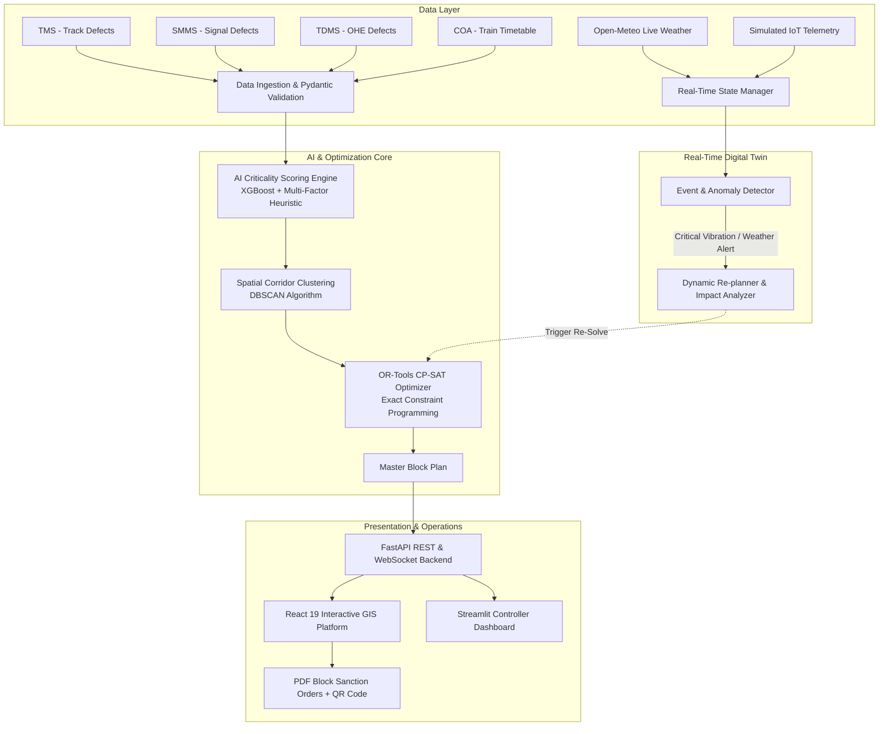

# PROJECT REQUIREMENTS SPECIFICATION (SRS) & SCOPE DOCUMENT

**Project Title:** AI-Powered Automatic Block Planning System to Maximize Asset Availability for Train Operations on Indian Railways  
**Problem Statement ID:** 26027  
**Domain / Track:** Smart Railways, Artificial Intelligence, Operations Research & Real-Time Cyber-Physical Systems  
**Document Version:** 1.0 (Final Academic & Institutional Submission)  
**Submission Target:** Departmental Evaluation Board / Higher Authority Review  

---

## 1. Executive Summary & Abstract

Indian Railways (IR) operates one of the largest rail networks in the world, running over 13,000 passenger trains and 8,000 freight trains daily. Balancing high-frequency train traffic with necessary track, signal, and overhead equipment (OHE) maintenance is a critical operational bottleneck. Currently, maintenance "blocks" (periods where train traffic is halted or regulated on a track section for repairs) are scheduled largely through manual negotiations between divisional controllers and three siloed departments: **Engineering (Track/TMS)**, **Signal & Telecommunication (S&T/SMMS)**, and **Electrical Traction (TRD/TDMS)**.

This project delivers an **AI-Powered Automatic Block Planning and Real-Time Digital Twin System** (Problem Statement 26027). The system ingests multi-department maintenance defects, scores asset failure risk using machine learning, clusters tasks spatially along railway corridors using DBSCAN, and solves a multi-objective mathematical optimization problem using Google OR-Tools CP-SAT. Furthermore, it integrates live environmental feeds (Open-Meteo weather API) and simulated IoT rail sensor telemetry to dynamically detect disruptions and trigger autonomous rescheduling with human-in-the-loop validation.

---

## 2. Problem Background & Motivation

1. **Siloed Departmental Planning:** Engineering, S&T, and Electrical departments currently submit block demands independently, leading to repeated corridor closures and severe traffic disruption.
2. **Sub-optimal Block Windows:** Manual planning struggles to evaluate thousands of combinations across corridor schedules (Control Office Application / COA), resulting in under-utilized blocks or train punctuality loss.
3. **Lack of Dynamic Reactivity:** Static weekly schedules cannot adapt when sudden rail anomalies (e.g., track fractures, extreme rail thermal stress, or flash storms) occur in real time.
4. **Safety vs. Throughput Dilemma:** Postponing maintenance risks catastrophic derailments, while uncoordinated blocks strangle line capacity and cause cascading train delays across adjacent railway divisions.

---

## 3. Project Objectives

1. **Automate Block Scheduling:** Eliminate manual guesswork by automatically generating conflict-free, multi-departmental weekly and monthly block schedules.
2. **Maximize Track Availability:** Maximize the productive train operating hours on high-density corridors (target: **≥ 88% asset availability**).
3. **Maximize Multi-Department Integration:** Cluster overlapping maintenance demands within the same spatial corridor window (target: **≥ 70% integrated "shadow" blocks**).
4. **Guarantee Safety & Deterministic Compliance:** Ensure zero constraint violations (headway, crew shifts, machine availability, power shutdown rules).
5. **Provide Real-Time Digital Twin Monitoring:** Incorporate live weather data and real-time telemetry to trigger dynamic re-planning within seconds of critical track events.

---

## 4. System Scope

### 4.1 In-Scope
* Ingestion and validation of defect data across Track Management System (TMS), Signalling Maintenance Management System (SMMS), and Traction Distribution Management System (TDMS).
* Ingestion of Control Office Application (COA) master corridor train schedules.
* ML-based Criticality Index scoring (0–100) combining structural risk, speed restrictions, and traffic density.
* Unsupervised spatial clustering (DBSCAN) along linear kilometer markers.
* Exact constraint satisfaction optimization (OR-Tools CP-SAT) for single- and double-line corridors.
* Dynamic event detector and autonomous re-planner for real-time corridor disruptions.
* Live real-time environmental monitoring (rainfall, temperature, wind speed, fog) via Open-Meteo.
* Full-stack interactive interface: React 19 Web GIS Dashboard, Plotly Gantt charts, and automated PDF Block Authority dispatch orders with QR verification.

### 4.2 Out-of-Scope (Future Enhancements)
* Direct write-access back into IR's closed internal production intranet (prohibited by Indian Railways security protocol; exportable formats and standard REST APIs are provided).
* Automated remote physical interlocking switching (the system provides advisory dispatch orders for Section Controllers to sanction).

---

## 5. Functional Requirements (FR)

| Req ID | Module | Functional Requirement Description |
| :--- | :--- | :--- |
| **FR-01** | **Data Ingestion & Validation** | The system shall ingest maintenance defect records from TMS (Civil), SMMS (S&T), and TDMS (Electrical), validate fields against strict Pydantic schemas, and merge them with COA corridor train timetables. |
| **FR-02** | **AI Criticality Scoring** | The system shall compute an asset **Criticality Index (0–100)** for every pending defect using an XGBoost regression model blended with a multi-criteria safety heuristic (evaluating defect severity, speed restriction impact, asset age, and track category). |
| **FR-03** | **Spatial Corridor Clustering** | The system shall use **DBSCAN (Density-Based Spatial Clustering)** with a spatial tolerance (epsilon = 2.0 km) to group cross-departmental defects that can be executed simultaneously under a single corridor block. |
| **FR-04** | **Constraint Optimization (CP-SAT)** | The system shall formulate and solve a mathematical constraint programming model using **Google OR-Tools CP-SAT**. It must respect hard constraints: corridor traffic windows, non-overlapping blocks on the same track, crew duty hours, equipment availability, and minimum maintenance durations. |
| **FR-05** | **Real-Time Digital Twin State** | The system shall maintain an in-memory thread-safe state manager representing the real-time condition of all corridor sections, active train positions, and sensor telemetry. |
| **FR-06** | **Live Environmental Ingestion** | The system shall periodically poll real-world weather metrics (temperature, precipitation, wind speed) from the **Open-Meteo API** for corridor coordinates and flag environmental thresholds (e.g., track buckling risk when rail temp > 55°C or storm risks). |
| **FR-07** | **Dynamic Re-Planning & Impact Analysis** | Upon receiving a critical anomaly (e.g., severe vibration > 8.0g, emergency track defect), the system shall calculate the **blast radius**, identify conflicting pre-scheduled blocks, and generate an updated block schedule within < 60 seconds without human manual recalculation. |
| **FR-08** | **Interactive Visualization & Dispatch** | The system shall provide a web-based dashboard displaying: (1) Interactive GIS track map (Leaflet), (2) Master Block Gantt chart (Plotly), (3) Live Event Ticker, (4) KPI analytics, and (5) One-click **PDF Block Sanction Order** generation with QR verification. |

---

## 6. Non-Functional Requirements (NFR)

| Req ID | Category | Specification & Benchmark |
| :--- | :--- | :--- |
| **NFR-01** | **Safety & Determinism** | **100% Deterministic Safety.** Block scheduling optimization must strictly rely on exact mathematical solvers (CP-SAT) with hard constraints. Generative LLMs are strictly excluded from safety-critical scheduling decisions to eliminate hallucination risk. |
| **NFR-02** | **Optimization Performance** | The optimization engine must solve a standard 7-day corridor maintenance problem (100+ tasks across 3 departments) in **under 60 seconds** on standard server hardware. |
| **NFR-03** | **Real-Time Responsiveness** | Real-time event detection and anomaly classification must have an execution latency of **< 200 ms**. Dynamic re-planning must complete in **< 30 seconds**. |
| **NFR-04** | **Reliability & Fault Tolerance** | The system must operate gracefully even if external weather APIs are unreachable, falling back to historical seasonal corridor baselines without crashing. |
| **NFR-05** | **Usability & Decision Support** | The UI must provide a **Human-in-the-Loop** approval mechanism where Chief Controllers can accept, review, or adjust proposed blocks before finalizing dispatch orders. |
| **NFR-06** | **Portability & Modularity** | The architecture must follow a clean modular design (independent AI, Optimizer, API, and Frontend packages) that can run on Linux, Windows, or within Docker containers. |

---

## 7. Hardware and Software Specifications

### 7.1 Hardware Requirements
* **Processor (CPU):** Intel Core i5 / AMD Ryzen 5 (4 cores, 8 threads) or higher (Recommended: 8 cores for multi-threaded CP-SAT solving).
* **Memory (RAM):** Minimum 8 GB DDR4 (Recommended: 16 GB).
* **Storage:** Minimum 10 GB available SSD space (for datasets, logs, model weights, and node modules).
* **Network:** Standard broadband/Ethernet connection (for live Open-Meteo API queries and web server access).

### 7.2 Software & Platform Requirements
* **Operating System:** Windows 10/11 (64-bit) or Linux (Ubuntu 20.04/22.04 LTS).
* **Python Runtime:** Python 3.10, 3.11, or 3.12 (64-bit).
* **Node.js Environment:** Node.js v18.0+ or v20.0+ (LTS) with npm v9+.
* **Core Libraries & Frameworks:**
  * **Backend & API:** `FastAPI` (>=0.115), `Uvicorn` (ASGI server), `Pydantic` (v2.8).
  * **Mathematical Optimization:** `ortools` (Google OR-Tools >=9.10 CP-SAT).
  * **AI / Machine Learning:** `xgboost` (>=2.1.0), `scikit-learn` (>=1.5.0), `pandas` (>=2.2.0), `numpy` (>=1.26.0).
  * **Frontend Web Application:** `React` (v19.2), `Vite` (v8.2), `Tailwind CSS` (v4.3), `Leaflet` (GIS maps), `Recharts` & `Plotly.js` (Gantt & analytical charts), `Lucide React` (icons), `jsPDF` (Sanction generation).
  * **Real-Time Ingestion:** `requests`, Python standard `threading` / `asyncio`, WebSockets / Server-Sent Events.

---

## 8. System Architecture & Pipeline Flow

---

## 9. Key Performance Indicators (KPIs) & Target Outcomes

| Metric | Baseline (Manual Planning) | Target with AI System | Impact / Benefit |
| :--- | :--- | :--- | :--- |
| **Track Asset Availability** | ~72% – 76% | **≥ 88.5%** | Maximizes capacity for high-speed Vande Bharat and freight trains. |
| **Multi-Dept Integration Rate** | 22% – 30% | **≥ 70%** | Allows Civil, S&T, and Electrical to work under a single track closure. |
| **Block Planning Time** | 4 – 6 days / division | **< 2 minutes** | Replaces lengthy inter-departmental manual coordination meetings. |
| **Dynamic Re-planning Time** | 3 – 5 hours (ad-hoc) | **< 60 seconds** | Immediate conflict resolution upon emergencies or rail anomalies. |
| **Scheduling Conflicts** | Frequent (~15–20/month) | **Zero (0)** | Mathematically verified constraint satisfaction. |

---

## 10. Project Deliverables

1. **Autonomous Optimization Engine:** Python package implementing multi-criteria scoring, DBSCAN spatial clustering, and CP-SAT mathematical solver.
2. **Real-Time Railway Digital Twin:** Live weather polling service and IoT telemetry anomaly detector with automated re-planning trigger.
3. **High-Performance FastAPI Backend:** REST API endpoints serving tasks, corridor sections, block plans, real-time alerts, and KPI analytics.
4. **Modern React 19 Web GIS Dashboard:** Professional frontend featuring interactive Leaflet route maps, Gantt timeline, live event ticker, and blast-radius impact graphs.
5. **Operational Dispatch Module:** Automated generation of formal Railway Block Sanction authority documents in PDF format with embedded QR verification codes.
6. **Comprehensive Documentation & Tests:** Complete codebase, requirements specification, setup manuals, and test scripts.
